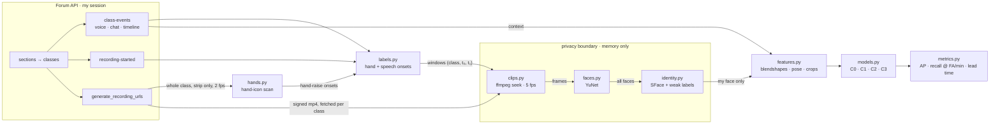

# Pipeline 1 plan — *The Tell*

> **Can a model that only watches my face tell that I'm about to raise my hand in class — and how
> many seconds before I do?**

In poker a *tell* is the involuntary sign that gives away what you are about to do. Minerva
records every class on Forum. The recording shows the moment a raised-hand icon appears on my
tile, and Forum's event log records, to the millisecond, every time I speak. Three years of
classes form a labelled video archive of me deciding to contribute. This pipeline looks for my
tell.

| | |
|---|---|
| **Due** | Fri 16 Oct 2026 (Forum). Closes Sun 18 Oct; no late work after Mon 19 Oct 01:00. |
| **Time left** | Four working days from Mon 12 Oct. The schedule in [§10](#10-schedule) is built around that. |
| **Status** | Planned. Forum API and frontend code checked live on 12 Oct ([§2](#2-what-the-data-actually-is-verified-12-oct-2026)); hand-icon detector prototyped on one real frame. No pipeline code yet. |
| **Presentation** | [`site/index.html`](site/index.html) — interactive pipeline and data-flow explorer |

---

## 1. The question, and where its labels come from

The target is the moment I **raise my hand** (press `H` in Forum). Forum saves every hand raise,
but no student-readable API returns them (§2.1), so the labels are recovered from the
recording itself:

- **Hand-raise onsets, from the video.** The recording is a capture of the whole Forum
  interface. When I press `H`, a yellow-green hand icon appears in the top-left corner of my tile
  in the strip of faces. A colour test on that corner tells hand icons apart from the green poll
  ticks that sit in the same place. On a frame from CX50 Session 3 it found exactly the two raised
  hands that Forum's own *Class Signals* counter showed (§2.2).
- **Speech onsets, from the event log.** Forum logs every time I speak, with millisecond timing:
  576 of my `voice` events in a 32-class sample alone. These need no video scan.

Hand-raise onsets are the primary target. Speech onsets are a second target and a cross-check:
most of my hand raises should be followed by my speaking once I'm called on. Having both also
gives a direct comparison: *is a hand raise easier or harder to see coming than speech?*

---

## 2. What the data actually is (verified 12 Oct 2026)

Every endpoint below was called live from my logged-in Forum session. Auth is the session cookie;
nothing needs an API key.

| What | Endpoint | What came back |
|---|---|---|
| Me | `GET /api/v1/users/self?show_inactive=false` | my user id, name, role (used to pick out *my* events; never hard-coded) |
| Current sections | `GET /api/v1/sections?hide-defaults=true` | 6 sections (Fall 2026) |
| Past sections | `GET /api/v1/sections?state=past&hide-defaults=true` | 47 sections, Fall 2023 → Spring 2026; 46 flagged `should-record-sessions` |
| Classes in a section | `GET /api/v1/paginated-classes?category=past&page_size=50&filter_section_id={sid}` | `{count, next, results}`; each class has `recording-sessions` |
| Class events | `GET /api/v1/class_grader/classes/{cid}/class-events` | `voice`, `message`, `timeline-segment`, `bookmark-note` (≈190 voice events per class) |
| Recording timing | `recording-sessions[]` on each class | `recording-started`, `recording-ended` (UTC) |
| Video | `GET /api/v1/recording-sessions/{cid}/generate_recording_urls` | `{highres: …/recording.mp4, lowres: …/zencoder-recording-600k.mp4}`, CloudFront-signed, expiring |
| Breakouts | `GET /api/v1/class_grader/classes/{cid}/breakouts` | breakout groups (found in the grader's code) |
| Full classroom model | `GET /api/v1/classes/{cid}` | every classroom setting (`ptt-mode`, `teacher-user-id`, …) |
| Polls (pipelines 2–3) | `…/classes/{cid}/polls`, `…/poll-responses` | my written in-class answers |

**Size of the archive.** Across my 53 sections there are **694 recorded class sessions**.

**What a voice event looks like** (fields verified; values from CS156 Session 10, 8 Oct 2026):

```json
{ "event-type": "voice", "actor-id": "<me>", "room-id": "<main room>",
  "start-time": "2026-10-08T15:06:23Z", "end-time": "2026-10-08T15:07:16Z",
  "timestamp": 1791472036041, "event-data": { "duration": 53000 } }
```

Six details that the code has to get right:

1. **For `voice`, `timestamp` is the *end* of the utterance, in epoch milliseconds.**
   `start-time` and `end-time` are rounded to whole seconds. Precise onset =
   `timestamp − duration`. (Verified: start 14:59:45, end 14:59:55, timestamp = 14:59:55.041.)
   For `message` and `timeline-segment` events, `timestamp` is the *start*. In 2023 classes,
   timestamps are whole seconds (`…000`); in 2026 classes they carry real milliseconds.
2. **Two key spellings.** A direct API call returns kebab-case (`actor-id`, `event-type`). Forum's
   own web app gets snake_case (`actor_id`, `event_type`) from the same URL, depending on a request
   header. The parser accepts both.
3. **Video time = event time − `recording-started`.** For the event above: 15:06:23 − 14:59:05
   = 438 s = 0:07:18, the same time Forum's own review player shows. That proves the arithmetic,
   not the video; the audio alignment still has to be measured ([§9](#9-day-1-checks)).
4. **Voice events are fragmented.** My event durations: p10 0.33 s, median 2.9 s, p90 30 s.
   The median gap between my consecutive events is 12–14 s in discussion-heavy courses. One
   spoken contribution is often several events, so they must be merged into turns.
5. **`room_signature` = `"Main Classroom"` marks the main room.** The recording only covers the
   main room, so breakout speech is dropped.
6. **`recording-state` is `NOREC` on all 694 sessions**, including ones with video. Ignore it.

Three quirks that cost time if you don't know them:

- Unfiltered `/api/v1/paginated-classes` returns **11,984 classes org-wide back to 2014** and
  ignores `section=` / `section_id=`. Only `filter_section_id` works.
- The analytics path is `/api/v1/analytics/class/{cid}`, not the `/analytics/{session-id}` the
  Notion hub lists. It returns 403 for a student.
- My speaking rate varies by course. In a 32-class sample: 26 voice events/class (Complex
  Systems, F23), 39 (a business course, F24), 7 (CS156, F26), and **0** in one Spring 2024
  section. That section needs checking: missing events, or a course where I never spoke?

### 2.1 Where hand raises go (from Forum's own frontend code)

Forum's JavaScript bundles are public static files. Reading them shows exactly what pressing `H`
does:

- `h` is bound to `raiseHand` → `currentClassUser.toggleHandRaise()` →
  `saveThenPublish("hand-raised", true)`. That is a **PATCH to `/api/v1/class-users/{id}`**,
  which saves only the *current* state, plus a WebSocket broadcast so the room sees the icon.
  The endpoint answers GET with 405, so the state can't be read back. Nothing here ever writes
  to it.
- The server does keep a tally. The professor dashboard reads `user_engagement.hand_raises`,
  `reactions` and `chat_messages` per student from `/api/v1/analytics/class/{cid}`. That
  endpoint is 403 for students, and it returns counts, not times.
- The class grader (the review page) renders only four event types: `voice`, `message`,
  `timeline-segment` and `bookmark-note`. My account gets no hand events from `class-events`.
  Even if a professor's response included them, their review page wouldn't show them.

So there is no API route to timestamped hand raises for a student. Two other routes exist:

1. **The video (used here).** It shows every hand raise in every recorded class (§2.2).
2. **Live logging (validation only).** For classes still to come, the Scribe v3 extension can
   log my own `H` presses as they happen. That gives exact ground truth for a handful of raises,
   to measure the video detector's timing error. The professor-only per-class `hand_raises`
   counts would also check the detector's counts, if Prof. Watson is willing to share my own
   numbers.

### 2.2 The hand icon in the recording

The recording is a screen capture of the whole Forum interface: the strip of tiles along the top,
each with a **name label**; the slides; the class chat; and a *Class Signals* panel that counts
raised hands. Raising a hand puts a yellow-green circle with a white hand in the **top-left
corner of the tile**. That is the same spot as the green tick for a poll answer, but a
different hue. The speaker's tile gets a green border.

A prototype colour test on a frame from CX50 Session 3 (1:19:20):

| | Hue band | Found | Truth |
|---|---|---|---|
| Hand icon | 52–80°, saturation and value > 0.45 | 2 blobs, both on tiles showing the icon | Class Signals showed **2** raised hands ✓ |
| Poll tick | 120–165° | 11 blobs | the ticked tiles, plus the speaker's green border |

No false hand detections. Finding *which* tile is mine is the harder part. A quick OCR pass on
the name labels read four names correctly and missed "Brady", so my tile is found by face
matching (§6), with OCR as a cross-check.

---

## 3. Where the code lives (two repos, kept separate)

| Repo | Role in this pipeline |
|---|---|
| [`Brady-Rutherford/Minervas_scribe`](https://github.com/Brady-Rutherford/Minervas_scribe), branch `v3` | **Harvester.** `scribe sync` pulls every section, class, event list and recording timing into `pipeline1/data/raw/`; `scribe probe` checks a recording's resolution; `scribe_core.forum_events` is the one canonical event parser (both key spellings, per-type timestamp rules, the main-room rule), and `scribe_core.calibrate` measures the clock offset. Stays its own project. |
| this repo, `pipeline1/` | **The ML pipeline.** Labels, clip extraction, face pipeline, features, models, evaluation, write-up, site. |

This repo installs `scribe_core` as an ordinary dependency
(`uv add "scribe-core @ git+https://github.com/Brady-Rutherford/Minervas_scribe@v3"` once `v3`
is pushed). The repos never merge.

Target layout of this folder:

```
pipeline1/
  README.md            the write-up (template now, filled in Friday)
  PLAN.md              this file
  site/index.html      presentation: pipeline + data-flow explorer
  tell/                pipeline stages as importable modules
    hands.py           strip scan: tile segmentation + hand-icon colour test → hand-raise onsets
    labels.py          hand-raise onsets + voice turns → fresh onsets → sampled windows
    clips.py           ffmpeg window reader (signed URL → frames in memory)
    faces.py           YuNet detection, strip/stage regions
    identity.py        weakly supervised me-vs-not-me on SFace embeddings
    features.py        MediaPipe blendshapes + head pose; context features from events
    models.py          C0–C4
    metrics.py         average precision, onset recall @ false alarms/min, lead time
  pipeline1.ipynb      the run notebook, committed WITH outputs
  data/                gitignored: raw JSON, my face crops, features, scores
  .env                 gitignored: FORUM_COOKIE
```

---

## 4. The pipeline



| # | Stage | In → out | Tool | Why it's here |
|---|---|---|---|---|
| 1 | **Harvest** | Forum API → `data/raw/{cid}/*.json`, `manifest.csv` | `scribe sync` | 694 classes of metadata in ~20 min, resumable; no video yet |
| 2a | **Hand scan** | signed URL → my tile's hand state at 2 fps → `hand_onsets.parquet` | ffmpeg crop of the strip + colour test (§2.2) | the hand-raise labels; streams the whole class but keeps only the thin strip of tiles, and saves none of it |
| 2b | **Labels** | hand onsets + voice events → `onsets.parquet`, `windows.parquet` | pandas | turns, fresh onsets, positive / negative windows ([§5](#5-labels)) |
| 3 | **Clips** | windows + signed URL → frames in RAM | ffmpeg `-ss` on the URL, `rawvideo` pipe | downloads ~5 min of each 90-min class, not the whole file |
| 4 | **Faces** | frame → face boxes, tagged *strip* or *stage* | OpenCV YuNet | fast, tiny, no extra install beyond `opencv-python` |
| 5 | **Identity** | face boxes → my face only | OpenCV SFace embeddings + logistic regression | labels itself from voice events ([§6](#6-identity-who-is-me-without-hand-labelling)) |
| 6 | **Features** | my face → 52 blendshapes + yaw/pitch/roll + box size; 112 px crop; context | MediaPipe Face Landmarker; events | interpretable features *and* raw pixels |
| 7 | **Models** | features → p(onset within H s) | scikit-learn, PyTorch (MPS) | comparison conditions ([§7](#7-models-and-comparison-conditions)) |
| 8 | **Evaluate** | scores → AP, recall @ false alarms/min, lead time | own metrics | an event-level metric that fits the question ([§8](#8-splits-and-metrics)) |

**Stages 3–5 stream.** ffmpeg writes raw frames to a pipe, detection and identity run on
each frame in memory, and only the crop of my face is written to disk. Full frames and
classmates' faces never reach the disk. That covers both privacy and storage: 43 GB free can't
hold full recordings, and at 112 px my crops for 150 classes come to well under 1 GB.

---

## 5. Labels

Times are in seconds of video, using the timing rules in §2.

**Hand-raise onsets (primary).** Scan the strip of each class at 2 fps. ffmpeg crops the strip
before decoding, so classmates' tiles exist only as pixels in memory. Split the strip into tiles
at the dark gutters between them, and find my tile (§6). In my tile's top-left corner *R*, the
hand state is

$$
h(t)=\mathbb 1\!\left[\frac{1}{|R|}\sum_{p\in R}\mathbb 1[\text{hue}_p\in[52^\circ,80^\circ],\ s_p>0.45,\ v_p>0.45]\ \ge\ \theta\right]
$$

A hand-raise onset is a 0 → 1 change in *h* that stays up for at least 1 s (debounced against
flicker and compression noise).

**Timing has to be exact, because the model must predict *before* the hand.** The positive
window ends *g* = 0.5 s before the icon appears. The face model then never sees the icon, or the
last half-second of reaching for the key; it only sees the face while I'm deciding. Two details
make that guard real rather than nominal:

1. **Re-time every onset.** At 2 fps the icon could have appeared anywhere in the half-second
   between the last "down" frame and the first "up" frame. After the scan, re-read just that
   second at the full frame rate (~25–30 fps) and take the first frame showing the icon. That
   pins the appearance to ±40 ms for one extra second of video per onset.
2. **The icon trails the key press.** Pressing `H` sends a PATCH and a broadcast before the
   recording agent draws the icon, so the press is slightly *earlier* than the icon. The guard
   is measured from the icon, so it already covers that lag. The g-sweep (§7) tests whether
   0.5 s is enough.

Checks on the detector:
- Most onsets should be followed by my speech within a couple of minutes (called on), or by my
  hand going down.
- When my icon appears, the *Class Signals* counter goes up by one.
- This week's live-logged `H` presses measure its timing error (§2.1).

**Speech onsets (second target)** are built from voice events alone, as follows.

1. **Turns.** Merge my main-room voice events when the gap between them is under *m* = 2 s.
2. **Fresh onsets.** A turn start *o_k* counts only if I was silent for at least *q* = 30 s
   before it. That keeps the moment I *decide to enter* and drops mid-conversation
   continuations. Also drop onsets in the first 60 s of the recording or inside a
   `Breakouts` timeline segment.
3. **Positive windows.** Frames in [*o_k* − *H*, *o_k* − *g*]. *H* is the horizon (default 5 s,
   swept over 1, 2, 5, 10) and *g* = 0.5 s is a guard band. It keeps the moment Forum moves
   me to the main stage, and my mouth starting to move, out of the positives.
4. **Negative windows.** 12 s windows sampled from main-room time where I neither speak nor
   start speaking: no speech of mine from 5 s before the window to *H* + 30 s after it.
   Three negatives per onset, drawn from the same class.
5. **Unused.** Everything else: the 30 s before an onset outside its window, my own speech,
   breakouts. These frames are ambiguous, so they are never trained on.

$$
y(t)=\begin{cases}
1 & \exists k:\; o_k-H \le t \le o_k-g \\
0 & t\in\mathcal{N} \\
\text{unused} & \text{otherwise}
\end{cases}
$$

Each window is 12 s at 5 fps = 60 frames, enough for every *H* in the sweep. **Positive
control:** the same face pipeline should easily detect frames *while* I'm speaking. If it
can't, the face pipeline is broken, not the hypothesis.

Expected yield, to be measured: about 5–8 fresh onsets per class where I spoke. A 150-class
first cut gives roughly 800–1,200 onsets. That is ample for logistic regression and workable for
a fine-tuned CNN.

---

## 6. Identity: finding my face without hand-labelling

The strip of faces along the top changes order between sessions, so position can't identify me.
Two signals in the recording do, and both are free:

1. **The speaker's tile gets a green border.** Whenever Forum's events say I'm the only person
   talking, the bordered tile is mine. That pins my tile's position in that class directly from
   pixels and events, with no face recognition. Re-anchor at each of my turns in case tiles
   reorder when people join or leave.
2. **The speaker is shown on the main stage.** That gives labelled face crops to train a face
   matcher, needed for stretches where I don't speak for a long time:

$$
\tilde z(f)=\begin{cases}
1 & f \text{ on stage},\ \text{speaker}(t)=\text{me},\ \text{exactly one face on stage}\\
0 & f \text{ on stage},\ \text{speaker}(t)\neq\text{me}
\end{cases}
$$

Embed each face with SFace (128-d, unit-norm) and fit
$\hat p_{\text{me}}(f)=\sigma(w^\top\phi(f)+b)$ on those weak labels. Apply it to the strip, and
keep the face with the highest $\hat p_{\text{me}}$ when it clears a threshold. Then audit 100
random accepted crops by eye and report the precision.

*Comparison inside the stage:* weakly supervised logistic regression vs. plain cosine
similarity to a "mean me" embedding.

*Fallback* if the stage does **not** follow the speaker: hand-pick about 30 crops of me once from
a contact sheet, use their mean embedding as the prototype, and keep the rest of the pipeline
unchanged.

---

## 7. Models and comparison conditions

Per-frame face vector: 52 MediaPipe blendshapes (e.g. `jawOpen`, `eyeLookDownLeft`, `browInnerUp`)
+ yaw, pitch, roll + face-box area (leaning in) = 56 values. For logistic regression, frame *t*
is summarised over the previous *W* = 2 s (10 frames): mean, last − first, and standard deviation.
That gives 168 features.

Context vector (from events alone, no video): minutes into class, seconds since my last turn,
seconds since anyone stopped talking, others' turns in the last 2 min, my turns so far,
timeline-segment type (poll / breakout instructions / discussion / other), professor talking now.

| ID | Condition | Input | Model | What it answers | Priority |
|---|---|---|---|---|---|
| B | Base rate | — | predict prevalence | the floor for average precision | must |
| **C0** | **Context only** | event features | logistic regression | how predictable am I from the rhythm of class alone, with no face? | **must** |
| **C1** | **Face features** | blendshapes + pose, 2 s summary | logistic regression | is there a tell, and which muscles carry it? | **must** |
| **C2** | **Face pixels** | 112 px crop, single frame | ResNet-18 (ImageNet) fine-tuned | does a CNN find more than the hand-built features? | **must** |
| C3 | Face over time | 10-frame blendshape sequence | GRU | does *motion* matter more than appearance? | should |
| C4 | Face + context | C1 ⊕ C0 | logistic regression | is the face complementary to context or redundant? | could |
| S-rand | C1, random frame split | | | how much does leakage inflate the score? | **must** |
| **g-sweep** | **C1 with the window ending *g* = 0.5, 1, 2 s before the icon** | | | **is the model seeing a decision, or just me reaching for `H`?** A tell that survives *g* = 2 s is about deciding | **must** |
| S-year | C1, train 2023–25 / test 2026 | | | does my tell survive new rooms, cameras and years? | should |
| H-sweep | C1 at *H* = 1, 2, 5, 10 s | | | how far ahead is the signal? | should |
| T-speech | C1 trained on speech onsets instead of hand-raise onsets | | | is a hand raise more anticipatable than speech? | should |

Every model is first trained on hand-raise onsets. T-speech reruns C1 with speech-onset labels.

The **must** rows deliver six conditions: baseline, two model families, the CNN, the leakage
contrast and the guard sweep. That is more than the required three, and every row answers a
different question.
C0 is the comparison that matters most. If context alone matches the face models, the honest
result is "there's no tell; I'm predictable from the class, not my face." That is still a strong
finding.

---

## 8. Splits and metrics

**Splits.** Frames 0.2 s apart are near duplicates, so a random frame split lets the model match
test frames to their own neighbours in training. All headline numbers use **GroupKFold by class
session** (5 folds). The random split (S-rand) is reported once, on purpose, to measure the
inflation. Kapoor & Narayanan (2023) catalogue this exact leakage.

**Frame level.** Average precision (area under precision–recall). Positives are rare, so ROC-AUC
flatters (Saito & Rehmsmeier 2015). The baseline AP equals the positive rate, which is reported
next to every score.

**Event level (new metric).** A frame score is not what a "you're about to speak" system would
use. It would raise an alarm. With alarm $a_\tau(t)=\mathbb 1[p(t)\ge\tau]$:

$$
\text{lead}_k(\tau)=o_k-\inf\{\,t\le o_k-g \;:\; a_\tau(s)=1\ \ \forall s\in[t,\;o_k-g]\,\}
$$

$$
\text{FA}(\tau)=\frac{\#\{\text{rising edges of } a_\tau \text{ in negative windows}\}}{\text{minutes of negative windows}}
$$

Sweeping τ traces **onset recall vs. false alarms per minute**, a free-response curve. The
headline is *recall and median lead time at 0.5 false alarms per minute*: how often, and how
early, the model would have known, at a nuisance rate a person could live with.

**Controls.** Shuffled labels should give AP ≈ base rate (negative control). The speaking-now
detector should score near-perfect (positive control).

---

## 9. Day-1 checks

These are unknowns the plan depends on. Each one gets checked on three classes before any bulk
extraction runs.

| # | Check | How | If it fails |
|---|---|---|---|
| 1 | **Resolution and strip-face size (now the critical one)** | `scribe probe --class ID` (or the video's size in the browser console) | the hand scan works at any size; the face models need my face at ≥ 40 px. Use `highres` for windows if `lowres` is too small. If both are too small, the face model runs on main-stage crops only |
| 2 | ~~Is the raised-hand icon drawn on tiles?~~ **Yes** (§2.2) | — | the face crop must still exclude the tile's top-left corner, or the model reads the icon |
| 3 | Does the green speaker border follow the voice events, and how fast? | strip frames at 10 of my onsets | fall back to face matching (§6, signal 2) |
| 3b | Hand-scan accuracy | 3 classes by eye at 2 fps; Class Signals counter; this week's live log | tune θ and the debounce |
| 4 | Is video time = event time − `recording-started`? | cross-correlate audio energy with all voice activity on 3 classes | apply the measured per-class offset δ* |
| 5 | Can ffmpeg seek inside the signed URL? | `ffprobe` shows faststart; time one 12 s read | download `lowres` whole, cut, delete (one class at a time) |
| 6 | Breakout speech | count my voice events by `room-id` | filter to the main room id |
| 7 | The section with zero events | inspect its class-events | exclude and report it in the data funnel |

Offset estimate for check 4, with *v(t)* = 1 when anyone is speaking per Forum and *a(t)* =
audio speech activity:

$$
\delta^\ast=\arg\max_{|\delta|\le 10\text{ s}}\ \sum_t v(t)\,a(t+\delta)
$$

---

## 10. Schedule

| Day | Work | Done when |
|---|---|---|
| **Mon 12** | Plan ✓. Scribe v3 harvester built. FORUM_COOKIE into `.env`; `scribe me`; `scribe sync` over all sections. | `manifest.csv` lists ~694 classes with voice-event counts |
| **Tue 13** | Day-1 checks. `hands.py` on 3 classes, checked by eye, then the hand scan for ~150 classes in the background. `labels.py` → onset tables + data funnel. Clip extraction starts as onsets land. | hand detector validated; funnel numbers known |
| **Wed 14** | `faces.py`, `identity.py` (weak labels + audit), `features.py`. C0, C1, S-rand vs grouped split. | first AP numbers; identity precision measured |
| **Thu 15** | C2 (ResNet-18 on MPS). C3 and the H-sweep if time allows. Event-level metric and the result figures. | comparison table filled |
| **Fri 16** | Fill in README, export the pipeline diagram, run `pipeline1.ipynb` top to bottom with outputs, push, submit. | submitted |
| Sat–Sun | Buffer. | |

If the week slips, cut in this order: C4 → S-year → C3 → H-sweep → T-speech. Never cut C0, the
grouped split or the controls. If the hand detector can't be validated by Wednesday, swap the
primary target to speech onsets, which need no video scan, and keep the hand result as a
partial finding.

---

## 11. Compute, storage, dependencies

- **Machine:** Apple M4, 43 GB free. ResNet-18 fine-tuning on about 100k 112 px crops runs on
  `mps` in well under an hour.
- **Bandwidth:** the face windows are about 25 × 12 s per class, a few GB for 150 classes. The
  hand scan has to *read* every class end to end, because a hand can go up at any moment. At
  600 kbps that is roughly 400 MB per 90-minute class, about 60 GB for 150 classes. It is streamed
  and discarded, never stored, and takes an evening in the background with 4 parallel workers.
- **New dependencies** (added to `pyproject.toml` when the code lands): `opencv-python`
  (YuNet and SFace ship as ONNX in the OpenCV model zoo), `mediapipe`, `torch`, `torchvision`,
  `pyarrow`, `tqdm`, `python-dotenv`, and `scribe-core` from the Scribe repo.

---

## 12. Privacy and ethics

The recordings contain my classmates. The rules:

- Classmates' faces exist only in memory inside the clip → face → identity loop (§4) and are
  never saved. Full frames are never saved.
- Classmates' actor ids are hashed in anything written to `data/`. No classmate's name, face,
  voice or words appears in the repo, the site or the figures. `data/` and `.env` are gitignored.
- Only my own face appears in figures.
- The professor suggested the project. Before Friday, confirm with Prof. Watson that using class
  recordings this way, for my own face only, is fine.
- Minerva's API Hub notes that institutional data-compliance terms are still being clarified.
  Everything here runs locally and nothing is sent to a cloud service.

---

## 13. Aiming at a 4

The example that scored a 3 (*Can ML tell Allison and Ingrid apart?*) used a Haar cascade +
KNN on about 100 hand-sorted photos, with random splits. Its own "possible extensions" asked for
more data, cross-validation and other classifiers. Against the 4 descriptor, "highly original
purpose using a broad number of tools that have not yet been covered":

- **Original purpose:** anticipating my own behaviour from a three-year video archive that only
  exists because Minerva records everything.
- **Data engineering:** a REST harvester; hand-raise labels recovered by computer vision from a
  screen-captured UI, after reading Forum's own frontend code to confirm no API exposes them;
  self-labelling from event logs; clock alignment; and remote seeking into signed video.
- **Tools beyond class so far:** face detection (YuNet), face embeddings (SFace), weak
  supervision, MediaPipe blendshapes, transfer learning (ResNet-18), a recurrent model (GRU),
  grouped cross-validation, and an event-level metric.
- **Meta-knowledge (#MLFlexibility):** a leakage experiment that quantifies its own trap,
  positive and negative controls, and a context-only baseline that can falsify the whole idea.

---

## 14. Where pipelines 2 and 3 go

| | Question | Adds |
|---|---|---|
| **P1, now** | *When* am I about to speak? | my face |
| P2, Week 13 | *Why then?* What in the class makes me speak? | Scribe v3 transcripts of the preceding 60 s, timeline segment, polls, other speakers; real hand-raise labels |
| P3, Week 15 | *What* will I say? | retrieval over 3 years of my assignments, poll answers and transcribed contributions; scored against what I actually said |

---

## 15. What I need from you

1. **FORUM_COOKIE.** In Chrome DevTools → Network, click any `forum.minerva.edu/api/…` request
   and copy the full `cookie` request header into `pipeline1/.env` as `FORUM_COOKIE=…`. It's a
   login credential: it stays on this machine, and it expires, so refresh it if `scribe me` fails.
2. **A yes from Prof. Watson** on using the recordings, own face only.
3. **The recording's real resolution.** With a class video playing in Forum's review page, run
   this in the DevTools console and paste the result:
   `(v => `${v.videoWidth}x${v.videoHeight} ${v.currentSrc.includes('600k') ? 'lowres' : 'highres'}`)(document.querySelector('video'))`

---

## References

- Kapoor, S., & Narayanan, A. (2023). Leakage and the reproducibility crisis in
  machine-learning-based science. *Patterns, 4*(9), 100804.
  https://doi.org/10.1016/j.patter.2023.100804
- Torreira, F., Bögels, S., & Levinson, S. C. (2015). Breathing for answering: The time course of
  response planning in conversation. *Frontiers in Psychology, 6*, 284.
  https://doi.org/10.3389/fpsyg.2015.00284
- Ishii, R., Otsuka, K., Kumano, S., & Yamato, J. (2016). Prediction of who will be the next
  speaker and when using gaze behavior in multiparty meetings. *ACM Transactions on Interactive
  Intelligent Systems, 6*(1).
- Skantze, G. (2021). Turn-taking in conversational systems and human-robot interaction: A
  review. *Computer Speech & Language, 67*, 101178.
- Google. MediaPipe Face Landmarker (52 blendshapes).
  https://ai.google.dev/edge/mediapipe/solutions/vision/face_landmarker
- Wu, W., Peng, H., & Yu, S. (2023). YuNet: A tiny millisecond-level face detector. *Machine
  Intelligence Research, 20*, 656–665.
- Zhong, Y., Deng, W., Hu, J., Zhao, D., Li, X., & Wen, D. (2021). SFace: Sigmoid-constrained
  hypersphere loss for robust face recognition. *IEEE Transactions on Image Processing, 30*,
  2587–2598.
- He, K., Zhang, X., Ren, S., & Sun, J. (2016). Deep residual learning for image recognition.
  *CVPR*.
- Saito, T., & Rehmsmeier, M. (2015). The precision-recall plot is more informative than the ROC
  plot when evaluating binary classifiers on imbalanced datasets. *PLOS ONE, 10*(3), e0118432.
